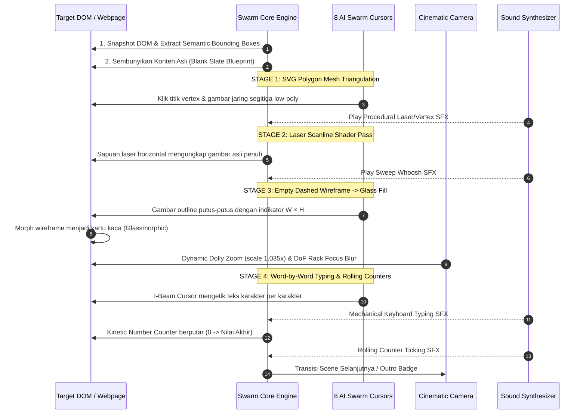
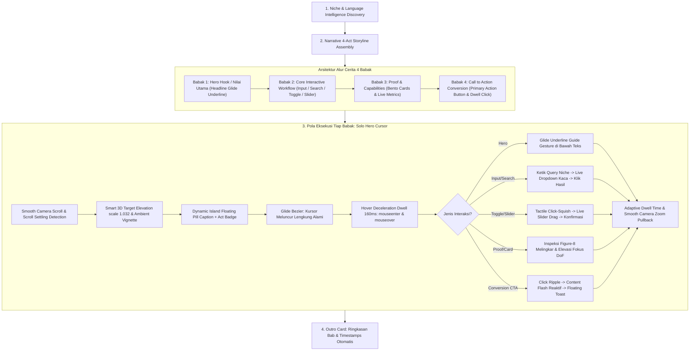
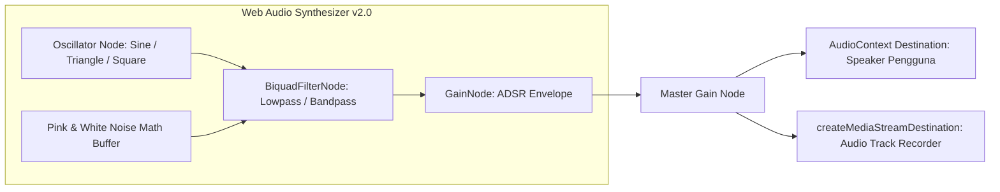
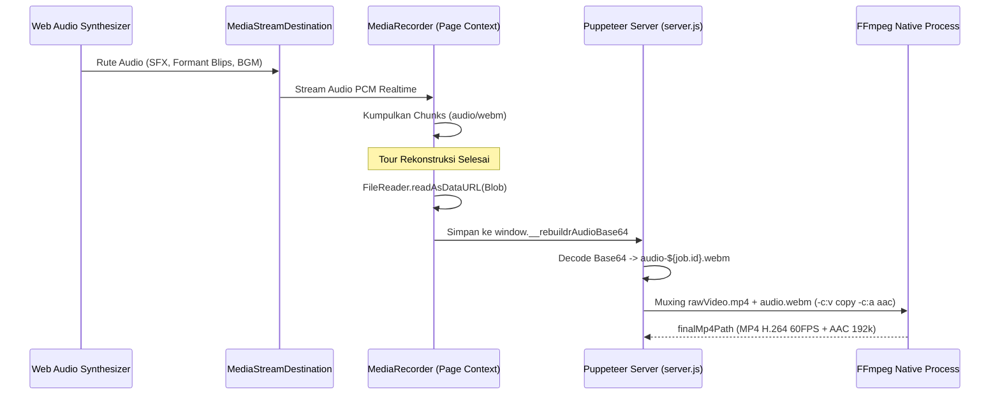
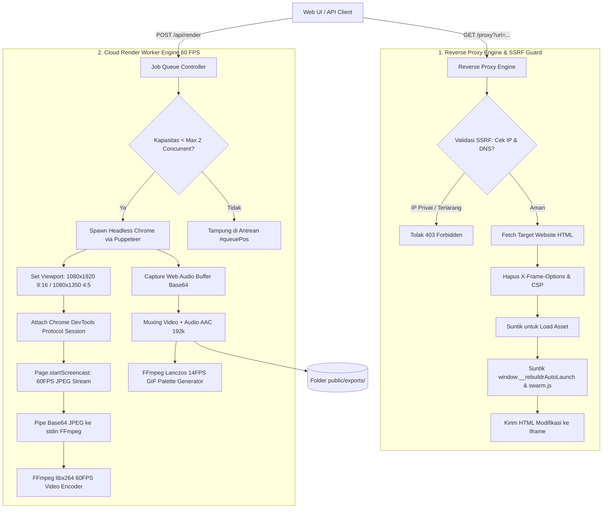
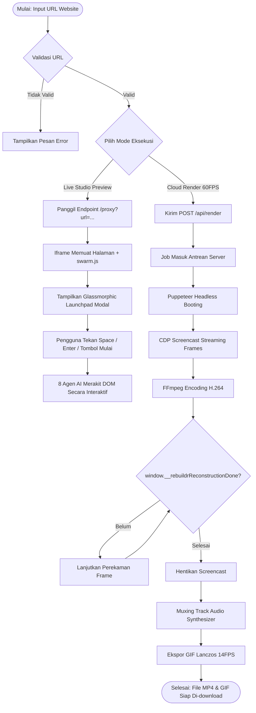

# ⚡ DOKUMENTASI LENGKAP: RANCANGAN SISTEM & MEKANISME REBUILDR STUDIO v3.6
> **Live DOM Multiplayer Cursor & Autonomous Website Motion Studio**  
> *Sistem Otomasi Perombakan & Perekaman Website Menjadi Video Motion Graphic Sinematik 60 FPS*

---

## 📑 DAFTAR ISI
1. [Ringkasan Eksekutif & Konsep Dasar](#1-ringkasan-eksekutif--konsep-dasar)
2. [Arsitektur Sistem Dual-Platform](#2-arsitektur-sistem-dual-platform)
3. [Rancangan Desain Antarmuka & Frontend (UI/UX Matrix)](#3-rancangan-desain-antarmuka--frontend-uiux-matrix)
4. [Mekanisme Inti Rekonstruksi DOM (The Swarm Engine)](#4-mekanisme-inti-rekonstruksi-dom-the-swarm-engine)
5. [Mekanisme Baru: Feature Tour Mode (Solo Hero Presenter & Live Interactive Demo)](#5-mekanisme-baru-feature-tour-mode-solo-hero-presenter--live-interactive-demo)
6. [Mekanisme Fisika 8 Agen AI Multiplayer](#6-mekanisme-fisika-8-agen-ai-multiplayer)
7. [Mekanisme Kamera Sinematik & Efek Visual](#7-mekanisme-kamera-sinematik--efek-visual)
8. [Mekanisme Audio Prosedural (Procedural Web Audio Engine)](#8-mekanisme-audio-prosedural-procedural-web-audio-engine)
9. [Mekanisme Backend Server, Reverse Proxy & Cloud Rendering](#9-mekanisme-backend-server-reverse-proxy--cloud-rendering)
10. [Alur Kerja End-to-End (Data Flow & Execution Lifecycle)](#10-alur-kerja-end-to-end-data-flow--execution-lifecycle)
11. [Spesifikasi Teknis Output Video & Format Media](#11-spesifikasi-teknis-output-video--format-media)
12. [Katalog Pintasan Keyboard & Kontrol Operasional](#12-katalog-pintasan-keyboard--kontrol-operasional)
13. [Struktur File & Direktori Proyek](#13-struktur-file--direktori-proyek)

---

## 1. Ringkasan Eksekutif & Konsep Dasar

### 1.1 Apa itu Rebuildr Studio?
**Rebuildr Studio** adalah platform otomasi pembuatan video *motion graphics* berbasis web yang mampu membongkar struktur live DOM (*Document Object Model*) dari website apa pun, kemudian merekonstruksinya dari awal secara bertahap menggunakan simulasi **8 kursor AI multiplayer kolaboratif** atau **Ghost Self-Building Mode** (merakit dirinya sendiri secara gaib).

### 1.2 Masalah yang Dipecahkan (The Problem)
* **Waktu Produksi Lambat:** Membuat animasi showcase portofolio atau video promo produk SaaS di Adobe After Effects atau Premiere Pro membutuhkan waktu 4–12 jam per video (memotong aset, menganimasikan keyframe posisi kursor satu per satu, masking elemen, dan typing text).
* **Kompleksitas Tooling:** Desainer dan pengembang web sering kali tidak memiliki lisensi atau keahlian motion design tingkat lanjut.
* **Perubahan Desain Berulang:** Jika UI website berubah, video showcase lama harus di-render ulang dari awal di software motion design.

### 1.3 Solusi Rebuildr (The Solution)
Hanya dengan **menempelkan link website (URL)** atau menekan pintasan tombol di browser:
1. DOM website didekonstruksi menjadi kanvas kosong.
2. 8 kursor AI melakukan triangulasi poligon SVG, memunculkan wireframe kotak bersumbu dinamis, mengetik teks huruf-demi-huruf, dan memutar angka metrik secara kinetik.
3. Kamera bergerak secara sinematik (*Dolly Zoom*, *Depth of Field Bokeh*, dan *Scene Transitions*).
4. Audio synthesizer menghasilkan SFX mekanik dan ketukan musik Lo-Fi/Synthwave secara *real-time*.
5. Cloud Engine / browser langsung mengekspor video beresolusi tinggi **60 FPS MP4** dan **animasi GIF Lanczos** siap unggah ke Instagram Reels, TikTok, YouTube Shorts, atau GitHub README.

---

## 2. Arsitektur Sistem Dual-Platform

Sistem Rebuildr dirancang dengan fleksibilitas tinggi menggunakan arsitektur ganda (*Dual-Platform Deployment*):

```mermaid
graph TD
    User([Pengguna / Kreator]) --> Choice{Pilih Platform Akses}
    
    %% Mode 1: Chrome Extension
    Choice -->|Buka Tab Browser Aktif| Ext[Mode A: Chrome Extension Manifest v3]
    Ext --> ExtShort[Shortcut Alt+Shift+S / Context Menu]
    ExtShort --> ExtInject[Injeksi background.js -> swarm.js ke Tab Aktif]
    ExtInject --> ExtHUD[Pre-flight Launchpad & In-DOM HUD Bar]
    ExtHUD --> ExtRec[MediaRecorder API Lokal Tab Capture 60FPS]
    ExtRec --> WebmDown[Ekspor Lokal: .webm Video File]

    %% Mode 2: Web Studio Cloud Server
    Choice -->|Input Link URL di Web Studio| Web[Mode B: Web Studio Cloud Server]
    Web --> Serv[server.js - Node.js HTTP & Worker]
    Serv --> Proxy[/proxy?url=... : Reverse Proxy & Base Href Fixer]
    Proxy --> Iframe[Live Preview Iframe Simulator]
    
    Serv --> Queue[Job Queue & Concurrency Controller]
    Queue --> Puppeteer[Puppeteer Core: Headless Chrome Worker]
    Puppeteer --> CDP[CDP Screencast: Page.startScreencast JPEG Pipe]
    CDP --> FFmpeg[FFmpeg Transcoder: libx264 60FPS CRF 18]
    Puppeteer --> AudioBuf[Procedural Web Audio Buffer Capture]
    AudioBuf --> Mux[FFmpeg Audio-Video Muxing]
    Mux --> OutMP4[Video Final: rebuildr-job_xxx.mp4]
    Mux --> OutGIF[GIF Animasi Lanczos: rebuildr-job_xxx.gif]
```

### 2.1 Mode A: Ekstensi Browser Chrome (Manifest v3)
* **Karakteristik:** Berjalan tanpa server luar, 100% *client-side* di browser pengguna.
* **Komponen:**
  * `manifest.json`: Konfigurasi permission tab, commands (`Alt + Shift + S`), dan background service worker.
  * `background.js`: Mendengarkan trigger shortcut dan menginjeksikan mesin `swarm.js` ke tab yang sedang aktif.
  * `icons/`: Ikon ekstensi berukuran 16px, 48px, dan 128px.
* **Perekaman:** Menggunakan Web Audio API + HTML5 `MediaRecorder API` dengan stream kanvas browser untuk menghasilkan file video `.webm` 60 FPS secara langsung.

### 2.2 Mode B: Rebuildr Web Studio & Cloud Render Server
* **Karakteristik:** Layanan web mandiri berbasis Node.js untuk siapa saja yang ingin mengonversi URL menjadi video tanpa perlu menginstal ekstensi browser.
* **Komponen:**
  * `server.js`: Server HTTP murni (zero-dependency backend selain `puppeteer-core`), mengelola reverse proxy, antrean render (`Job Queue`), worker headless browser, dan pipa transkoder FFmpeg.
  * `public/index.html`: Portal dashboard studio kontrol glassmorphic modern.
  * `public/app.css`: Desain sistem antarmuka responsif dengan efek kaca blur, bento grid, dan tema gelap.
  * `public/app.js`: Pengendali state UI, validasi URL, simulator iframe interaktif, dan polling status antrean render *real-time*.

---

## 3. Rancangan Desain Antarmuka & Frontend (UI/UX Matrix)

Antarmuka Rebuildr Web Studio di `public/index.html` dirancang dengan estetika *Developer-First Cyberpunk Glassmorphism*.

```
+-----------------------------------------------------------------------------------------+
|  ⚡ REBUILDR WEB STUDIO v3.6                 [⭐ Preset]  [📱 Live Preview]  [GitHub]    |
+-----------------------------------------------------------------------------------------+
|                                                                                         |
|       Tempel Link Website, Biarkan 8 Agen AI Merakit Videonya.                          |
|       Hasilkan video motion design showcase 60FPS untuk TikTok, Reels, atau pitch.     |
|                                                                                         |
|   +---------------------------------------------------------------------------------+   |
|   | 🔗 [ https://linear.app                                              ] [✕]      |   |
|   | Coba Cepat: [⚡ PULSE SaaS] [Visual Novel Yusuf] [Linear] [Stripe] [GitHub]     |   |
|   | ⚡ Custom Hook: [ BEFORE: Wireframe Kuno -> AFTER: Dirakit 8 AI ⚡           ]   |   |
|   | [ ▶ Buka Live Web Studio ]               [ ⚡ Auto-Generate Video (Cloud 60FPS) ]|   |
|   +---------------------------------------------------------------------------------+   |
|                                                                                         |
|   [ Konfigurasi 9 Parameter Rekonstruksi & Motion Design ]                              |
|   +-------------------+  +-------------------+  +-------------------+                   |
|   | 📐 Format Kanvas  |  | ⏱️ Target Durasi   |  | 🎵 Musik Latar     |                   |
|   | [16:9][9:16*][1:1]|  | [15s][30s*][60s]  |  | [LoFi*][Synth][Off|                   |
|   +-------------------+  +-------------------+  +-------------------+                   |
|   +-------------------+  +-------------------+  +-------------------+                   |
|   | 📱 Mockup Frame   |  | 🔀 Preset Hook    |  | ✨ Kurasi AI      |                   |
|   | [Flat*][iPh][Mac] |  | [Bef-Aft*][Teaser]|  | [Curated*][Full]  |                   |
|   +-------------------+  +-------------------+  +-------------------+                   |
|   +-------------------+  +-------------------+  +-------------------+                   |
|   | 🎬 Mode Kamera    |  | 🎨 Tema Blueprint |  | ⚡ Kecepatan      |                   |
|   | [Motion*][Scroll] |  | [Figma*][CAD][Neon|  | [1x][1.5x*][2x][3x|                   |
|   +-------------------+  +-------------------+  +-------------------+                   |
|                                                                                         |
|   +---------------------------------------------------------------------------------+   |
|   | 📱 LIVE WEB STUDIO PREVIEW SIMULATOR (Bezel iPhone 15 Pro / Desktop Stage)      |   |
|   | [ iFrame: /proxy?url=... + swarm.js Auto Injected ]                             |   |
|   +---------------------------------------------------------------------------------+   |
+-----------------------------------------------------------------------------------------+
```

### 3.1 Parameter Konfigurasi yang Didukung
1. **Format Kanvas Video:**
   * `16:9 Landscape` (1920 × 1080) — Untuk YouTube Desktop, presentasi, dan TV.
   * `9:16 Vertical` (1080 × 1920) — Dioptimalkan untuk Reels, TikTok, dan Shorts.
   * `1:1 Square` (1080 × 1080) — Untuk feed Instagram atau postingan LinkedIn.
2. **Target Durasi:**
   * `15s (Teaser)` — Kecepatan tinggi untuk retensi maksimal.
   * `30s (Viral Reels)` — Durasi seimbang untuk storytelling lengkap.
   * `60s (Deep Showcase)` — Menampilkan detail animasi dan seluruh section.
3. **Preset Hook Headline:**
   * Input teks bebas untuk banner pembuka (contoh: *"BEFORE: Wireframe Kuno -> AFTER: Dirakit 8 AI ⚡"*).
4. **Musik Latar (Procedural BGM):**
   * `Lo-Fi Beats`, `Synthwave`, atau `SFX Only`.
5. **3D Device Mockup:**
   * `Flat Studio` (kanvas datar), `iPhone 15 Pro` (bezel smartphone dengan Dynamic Island), atau `MacBook Pro`.
6. **Kurasi AI & Tata Letak:**
   * `Curated Scope`: Menyaring elemen yang berantakan (*noise filter*) dan merapikan grid.
   * `Full Page`: Memproses seluruh halaman dari header hingga footer.
7. **Mode Kamera Video:**
   * `Motion Design Cuts`: Berpindah per adegan dengan transisi kinetik (Zoom, Iris, Blinds, Glitch, Wipe).
   * `Smooth Auto-Scroll`: Kamera meluncur halus ke bawah mengikuti perakitan elemen.
8. **Tema Blueprint:**
   * `Figma Emerald` (hijau figma & grid tipis).
   * `Architect CAD` (garis cetak biru arsitektur teknik).
   * `Cyberpunk Neon Matrix` (kontras tinggi magenta & cyan).
9. **Kecepatan Rakit:**
   * Pilihan kelipatan kecepatan: `1×`, `1.5×`, `2×`, atau `3×`.

---

## 4. Mekanisme Inti Rekonstruksi DOM (The Swarm Engine)

Mesin utama [`swarm.js`](file:///d:/VIBE%20CODING/REBUILD/swarm.js) (terdiri dari 6.700+ baris kode Vanilla JS murni) bekerja melalui **4 Tahapan Sekuensial**:



### 4.1 Tahap 1: SVG Polygon Mesh Triangulation
* Gambar, ilustrasi hero, dan avatar tidak langsung dimunculkan.
* Kursor AI (`WebGL · Polygon`) bergerak ke koordinat gambar dan secara prosedural menaruh titik-titik vertex ($X, Y$).
* Ditarik garis-garis koneksi segitiga poligon (*Delaunay Triangulation*) dengan garis cyan/neon menyala di atas latar belakang transparan.

### 4.2 Tahap 2: Laser Scanline Shader Pass
* Setelah jaring poligon selesai dirangkai, efek *laser sweep* bergerak dari kiri ke kanan (atau atas ke bawah).
* Tekstur gambar asli beresolusi penuh terkuak tepat di bawah lintasan laser, sementara jaring poligon perlahan memudar (*fade out*).

### 4.3 Tahap 3: Empty Dashed Wireframe Box ke Glassmorphic Shader Fill
* Komponen seperti kartu produk, bento grid, tombol CTA, dan formulir input muncul terlebih dahulu sebagai **kotak kosong dengan garis putus-putus (dashed)**.
* Di sudut wireframe ditampilkan label ukuran piksel dinamis secara *real-time* (misalnya: `W: 380px × H: 220px`).
* Setelah posisi terkunci, wireframe bertransformasi menjadi kartu kaca modern (*backdrop-filter blur*, border glow, gradien gelap).

### 4.4 Tahap 4: Live DOM Typing & Kinetic Number Counter Roll
* **Text Typing:** Kursor pengetik teks (`Claude AI · Copywriter`) memposisikan dirinya di awal kalimat, memunculkan *caret* menyala, dan mengetik setiap huruf atau kata dengan kecepatan dinamis meniru ketikan manusia nyata.
* **Kinetic Counter Roll:** Angka metrik (seperti *"28+ Proyek"*, *"98% Presisi"*, *"2026"*) tidak diketik huruf-demi-huruf, melainkan berputar cepat dari angka 0 ke nilai target menggunakan kurva *cubic-bezier ease-out*, diiringi suara detakan mekanik (*counter roll ticks*).

---

## 5. Mekanisme Baru: Feature Tour Mode (Solo Hero Presenter & Cinematic 4-Act Storyline)

Sebagai evolusi besar dari mode *Rebuild from Scratch*, **Feature Tour Mode** dirancang dengan filosofi **Solo Hero Presenter**: menggunakan **1 kursor tunggal yang elegan, tenang, dan berpresisi tinggi** (seluruh 7 kursor lainnya otomatis disembunyikan). Mode ini mengubah Rebuildr dari "alat pembongkar tampilan" menjadi **asisten presenter produk digital otomatis sekelas Apple & Linear Keynote** yang menyajikan alur cerita naratif 4-babak yang memukau.



### 5.1 Filosofi 1 Kursor Tunggal (Solo Hero Cursor)
* **Zero Distraction:** Pada video promosi produk kelas dunia (Apple, Linear, Stripe, Framer), perhatian penonton harus tertuju ke antarmuka aplikasi, bukan kursor yang berseliweran.
* **1 Kursor Terfokus:** Kursor utama (`Yusuf · Presenter`) bertindak sebagai presenter tunggal yang mengarahkan pandangan, mengetik dengan caret realistis, dan mengklik tombol.
* **Smart Auto-Hide Crew:** Begitu preset `feature-tour` aktif, kursor 1 sampai 7 dinonaktifkan (`display: none`), dan hanya kursor 0 yang aktif dengan badge khusus `.is-solo-hero`.

### 5.2 Arsitektur Naratif 4-Babak (*Narrative 4-Act Storyline Discovery*)
Bukan sekadar memilih elemen acak, algoritma `discoverAndRankFeatures()` mengelompokkan kandidat fitur ke dalam struktur narasi 4 babak:
1. **Babak 1 — Hero Hook / Nilai Utama (`ACT 1 · HERO HOOK`):**
   - Memilih judul headline utama di hero banner (`h1`, `.hero-title`).
   - Kursor Solo Hero meluncur di bawah baris judul dengan *underline guide gesture* (`glideCursorUnderline`) memperkenalkan proposisi nilai produk.
2. **Babak 2 — Core Interactive Workflow (`ACT 2 · WORKFLOW`):**
   - Memilih search bar cerdas, kolom input interaktif, sakelar fitur toggle, atau range slider.
   - Mendemonstrasikan interaksi langsung: mengetik query kontekstual sesuai niche, memunculkan live search dropdown kaca, memilih hasil pertama, atau menggeser nilai slider secara live.
3. **Babak 3 — Proof & Capabilities (`ACT 3 · PROOF & METRICS`):**
   - Memilih kartu metrik performa (`.metric-card`, `99% Uptime`, `14x Speed`) atau kartu bento keunggulan arsitektur.
   - Elemen diangkat dengan elevasi 3D lembut, bagian sekitarnya mendapatkan efek bokeh kedalaman bidang (*soft depth-of-field*), dan kursor menuntun pandangan ke statistik pembuktian.
4. **Babak 4 — Call to Action Conversion (`ACT 4 · CONVERSION`):**
   - Memilih tombol aksi utama (*Primary CTA*: *"Mulai Eksperimen"*, *"Deploy Agent"*, *"Daftar Gratis"*).
   - Menghindari tindakan berbahaya (*safe filter*), melakukan deselerasi hover (*dwell hover*), click ripple, tactile squish, dan memicu confetti toast keberhasilan aktivasi.

### 5.3 Dynamic Island Floating Pill Caption
Desain caption telah ditingkatkan dari kotak gelap konvensional menjadi kapsul mengambang modern (*Dynamic Island Floating Pill*):
* **Bentuk & Gaya Visual:** Sudut kapsul melengkung penuh (`border-radius: 9999px`), kaca gelap tembus pandang (`background: rgba(8, 12, 24, 0.88)`), blur optik tinggi (`backdrop-filter: blur(20px)`), dan kilau tepi brand neon.
* **Badge Babak Dinamis (`.tour-caption-act`):** Menampilkan lencana kecil di atas judul (misalnya `ACT 1 · HERO HOOK`, `ACT 2 · WORKFLOW`), memberikan konteks alur cerita secara instan.
* **Copywriting Berorientasi Manfaat:** Kalimat keterangan ditulis secara ringkas dan menonjolkan keuntungan bagi audiens (misal: *"Instant contextual query"*, *"High-performance verified component architecture"*).
* **Dynamic Collision Avoidance:** Jika elemen yang didemokan berada di bagian bawah layar (`bottom > 58%`), kapsul caption otomatis berlabuh di sisi atas (`.is-top-docked`) sehingga **tidak pernah menutupi fitur yang sedang disorot**.

### 5.4 Spotlight Ambient Vignette & Smart 3D Dolly Zoom
* **Ambient Soft Vignette:** Menggantikan lapisan hitam pekat 78% yang suram dengan gradien ambient lembut (`rgba(3, 7, 18, 0.28)`) dan cincin cahaya brand luminous, menjaga visual keseluruhan website tetap cerah dan elegan.
* **Smart 3D Target Elevation:** Elemen yang sedang disorot diberi kelas `.swarm-tour-target-elevated` dengan pembesaran lembut 3.2% (`transform: scale(1.032)`), bayangan kedalaman 3D (`box-shadow: 0 20px 48px rgba(0,0,0,0.4)`), dan garis aksen luminous tanpa merusak kalkulasi koordinat `position: fixed` dari overlay studio.
* **Soft Neighboring Depth-of-Field:** Bagian container saudara di sekeliling elemen aktif otomatis menerima kelas `.swarm-tour-bg-dimmed` (`filter: blur(2px) brightness(0.92)`), menghasilkan fokus sinematik layaknya kamera bioskop berapertur lebar.

### 5.5 Pacing Manusiawi, Scroll Settling & Hover Deceleration
* **Scroll Settling Detection (`smoothScrollToElement`):** Kamera tidak lagi sekadar tidur dengan jeda waktu kaku, melainkan memantau posisi `window.scrollY` hingga pergerakan scroll benar-benar berhenti (*stationary settling loop*). Spotlight dan kursor hanya muncul setelah antarmuka tenang 100%.
* **Hover Deceleration Dwell (~160ms):** Sebelum kursor melakukan klik pada tombol, tab, atau input, kursor berhenti sejenak sambil menembakkan event `mouseenter` dan `mouseover`. Status hover CSS (perubahan warna tombol, bayangan tombol) terpicu secara realistis persis seperti tangan manusia sebelum menekan mouse.

### 5.6 Mesin Lintasan Lengkung Bezier Alami (*Organic Bezier Trajectory Engine*)
Kursor tidak meluncur lurus kaku, melainkan menggunakan rumus kurva kuadratik Bezier dengan akselerasi dinamis:
* **Formula Bezier Kuadratik:**
  $$\mathbf{B}(t) = (1-t)^2 \mathbf{P}_0 + 2(1-t)t \mathbf{P}_1 + t^2 \mathbf{P}_2, \quad t \in [0, 1]$$
* **Titik Kontrol Lengkungan ($\mathbf{P}_1$):** Dihitung secara tegak lurus (*perpendicular normal vector*) terhadap garis lurus awal-ke-akhir ($\mathbf{P}_0 \rightarrow \mathbf{P}_2$) dengan magnitudo lengkungan dinamis ($\text{arch} \times 0.22 \times \text{distance}$).
* **Perataan Easing (Cubic Ease-in-Out):**
  $$E(p) = \begin{cases} 4p^3 & p < 0.5 \\ 1 - \frac{(-2p+2)^3}{2} & p \ge 0.5 \end{cases}$$
* **Velocity Tilt & Banking:** Menghitung sudut kemiringan rotasi kursor berdasarkan vektor kecepatan gerak ($\text{vx}, \text{vy}$), memberikan efek miring dinamis hingga $\pm 14^\circ$.
* **Micro-Overshoot:** Kursor sedikit meleset 3px melewati target lalu membal kembali secara elastis (*spring settle*), meniru gerak motorik tangan manusia.

### 5.7 Human-like Gestures: Kursor Morphing, Click-Squish & Underline Guidance
* **Morphing Cursor State:** Kursor presenter berubah wujud secara dinamis sesuai konteks:
  - `pointer` saat mendekati tombol CTA, tab filter, dan sakelar.
  - `text` (I-beam typing caret) saat mengisi form atau search bar.
  - `grab` dan `grabbing` saat menggenggam dan menggeser range slider.
* **Click-Squish Animation:** Ketika kursor melakukan klik nyata (*mousedown*), elemen kursor mengalami kompresi elastis (`transform: scale(0.82) rotate(-6deg)`) selama 110ms lalu membal kembali dengan spring bounce, memberikan rasa sentuhan fisik (*tactile feedback*).
* **Underline / Scrubbing Guidance Gesture:** Sebelum menginspeksi kartu metrik atau judul penting, kursor meluncur secara horizontal di bawah baris teks (`glideCursorUnderline`) sambil menyalakan garis luminous brand-color, menuntun mata penonton ke poin kunci.

### 5.8 Deteksi Niche & Generator Mock Data Kontekstual Bilingual (EN/ID)
Sistem tidak lagi mengetik data dummy generik ("Lorem ipsum" / "test"). Mesin secara cerdas memindai atribut bahasa dokumen (`<html lang>`), teks heading, kata kunci, dan meta tags untuk menentukan niche website serta bahasa yang sesuai (dapat di-override manual via Studio Dashboard):
1. **E-Commerce:**
   - *Bahasa Indonesia:* Pencarian *"Sepatu Running Ultra Pro"*, dropdown *"Kemeja Linen Oversize"*, toast *"🛍️ Produk Berhasil Ditambahkan ke Keranjang!"*.
   - *English:* Pencarian *"Ultra Pro Running Shoes"*, dropdown *"Oversized Linen Shirt"*, toast *"🛍️ Item Added to Bag Successfully!"*.
2. **Fintech & Banking:**
   - *Bahasa Indonesia:* Pencarian *"Portofolio Saham & Reksadana"*, dropdown *"Kartu Kredit Virtual Instant"*, toast *"💳 Koneksi Akun Keuangan Berhasil Diotorisasi!"*.
   - *English:* Pencarian *"Stock & Mutual Fund Portfolio"*, dropdown *"Instant Virtual Credit Card"*, toast *"💳 Financial Account Connected!"*.
3. **Creative Studio / Portofolio:**
   - *Bahasa Indonesia:* Pencarian *"Desain Sistem Modern & Minimalis"*, dropdown *"Wireframe & Prototyping Interaktif"*, toast *"✨ Katalog Proyek & Portofolio Dibuka!"*.
   - *English:* Pencarian *"Modern & Minimalist Design System"*, dropdown *"Interactive Prototyping & Wireframes"*, toast *"✨ Project Showcase Opened!"*.
4. **Edukasi & Kursus Online (EdTech):**
   - *Bahasa Indonesia:* Pencarian *"Belajar Fullstack AI & Web 2026"*, dropdown *"Masterclass Fullstack AI & Next.js"*, toast *"🎓 Pendaftaran Modul Kursus Berhasil!"*.
   - *English:* Pencarian *"Master Fullstack AI & Web 2026"*, dropdown *"Fullstack AI & Next.js Masterclass"*, toast *"🎓 Course Module Enrolled Successfully!"*.
5. **Kuliner & Restoran (F&B):**
   - *Bahasa Indonesia:* Pencarian *"Signature Artisan Coffee & Wagyu"*, dropdown *"Reservasi Meja VIP Malam Ini"*, toast *"🍽️ Reservasi Meja Berhasil Dikonfirmasi!"*.
   - *English:* Pencarian *"Signature Cold Brew & Wagyu Steak"*, dropdown *"VIP Rooftop Table Reservation"*, toast *"🍽️ Table Reservation Confirmed!"*.
6. **SaaS & Cloud (Default):**
   - *Bahasa Indonesia:* Pencarian *"Cloud Neural Grid"*, dropdown *"Real-time Telemetry Analytics"*, toast *"🚀 Fitur Sandbox & API Berhasil Diaktifkan!"*.
   - *English:* Pencarian *"Cloud Neural Grid Workspace"*, dropdown *"Real-time Telemetry Analytics"*, toast *"🚀 Sandbox & API Workspace Activated!"*.

### 5.9 Ekosistem Micro-Interactions Lengkap
Demo produk terasa hidup karena aksi kursor memicu reaksi langsung pada berbagai elemen DOM:
1. **Live Search Dropdown:** Saat kursor mengetik di kolom pencarian, seketika muncul menu *dropdown* hasil pencarian bergradien kaca (`#swarm-tour-search-dropdown`). Kursor meluncur melengkung ke hasil pertama dan mengkliknya.
2. **Toggle Switches (`input[type="checkbox"]` & `[role="switch"]`):** Kursor membidik sakelar, melakukan click-squish, membalik status on/off disertai efek suara mekanik `playToggle()`, memicu kilau pada UI, dan memunculkan toast konfirmasi.
3. **Range Sliders (`<input type="range">`):** Kursor berubah ke mode `grab`, menggenggam thumb slider (`grabbing`), lalu menyeret nilai dari kiri ke kanan secara bertahap sambil memainkan perkusif `playSliderTick()`, memperbarui data real-time pada halaman.
4. **Select Dropdowns (`<select>`):** Kursor membuka dropdown, memilih opsi preset, memainkan efek pop audio `playPop()`, dan memperbarui konfigurasi.
5. **Accordions & `<details>` Support:** Ketika elemen akordion FAQ didemokan, kursor mengklik summary, membuka konten, memberi highlight latar, menunggu jeda membaca, lalu menutupnya kembali dengan bersih.
6. **Horizontal Swipe / Flick pada Carousel & Swiper:** Kursor beralih ke mode `grab` lalu `grabbing`, melakukan swipe horizontal halus menggeser container (`scrollBy`), diiringi audio `playSliderTick()`.
7. **Reactive Content Flash & Toast:** Saat tab ditekan, kartu bento grid di sekitarnya bereaksi membesar halus (`scale 1.025`) dengan kilau aksen. Tombol CTA utama memunculkan floating toast mengambang di layar (`#swarm-tour-toast`).

### 5.10 Segmented Story Progress Bar (Instagram Stories Style)
* Di bagian paling atas viewport (`#swarm-tour-story-bar`), ditampilkan linimasa bersegmen tipis modern ala Instagram Stories.
* Jumlah segmen terbagi rata sesuai total fitur yang didemokan ($N = 3, 5, \text{atau } 7$) dan dipotong ketat (`selected.slice(0, targetCount)`) sehingga durasi video selalu akurat.
* Segmen yang telah selesai terisi penuh 100% warna brand, segmen yang sedang aktif terisi dinamis seiring jalannya demo, dan segmen masa depan tampak tembus pandang elegan.

### 5.11 Dual Audio System: Procedural Formant Blips vs Narasi TTS
Rebuildr secara transparan membedakan efek suara vokal prosedural dan narasi tutur manusia:
* **Procedural Vocal Formants (Retro Gibberish SFX):** Mesin Web Audio menyintesis gelombang vokal (*dual-bandpass resonant formant blips* $F_1, F_2$ pada frekuensi $200–850\text{ Hz}$) yang disinkronkan ke setiap kata caption. Karakter audionya menyerupai bunyi bicara interaktif ala game retro (*Animal Crossing* atau *Simlish*), berfungsi memberikan umpan balik taktil tanpa klaim berlebihan sebagai voiceover manusia. Karena terhubung ke `masterGain` dan `recordDest`, **suara vokal formant ini 100% terekam ke dalam file video MP4 hasil render cloud!**
* **Browser Speech Synthesis (Local Playback):** Di lingkungan browser interaktif lokal, opsi `window.speechSynthesis` dapat diaktifkan untuk membacakan caption dengan artikulasi kata manusia natural (ID/EN).
* **Server Neural TTS Pipeline (Cloud Headless):** Untuk voiceover vokal manusia sejati pada proses render cloud, arsitektur server dapat menjalankan TTS engine lokal (misalnya Piper TTS atau espeak-ng) untuk mengekspor track vokal audio berdasar naskah storyboard, kemudian di-mux secara presisi dengan FFmpeg menggunakan offset penanda waktu adegan.

### 5.12 Interactive Takeover Engine, Floating Audio Toggle & Pilihan Gaya Overlay
* **Interactive Takeover:** Rebuildr menyediakan tombol kaca mengambang `#swarm-tour-takeover-btn` (*"👆 Coba Sendiri"*). Saat ditekan oleh pengunjung, AI kursor berhenti dan memudar secara halus, memulihkan kontrol pointer penuh ke pengguna. Tombol berubah menjadi *"▶ Lanjutkan Demo AI"* untuk melanjutkan tour otomatis.
* **Penyembunyian Otomatis Elemen Interaktif Saat Merekam:** Saat mode render headless aktif (`body[data-fullscreen-render="true"]`), tombol interaktif `#swarm-tour-takeover-btn`, toggle suara `#swarm-tour-sound-btn`, dan resume button disembunyikan secara otomatis agar hasil rekaman video bersih dari tombol operasional.
* **Opsi Gaya Overlay Tour:** Studio Dashboard menyediakan kontrol *"Gaya Overlay Tour"*:
  1. **📱 Stories Bar & Caption (Full Overlay):** Menampilkan linimasa segmen bar dan floating caption teks untuk format reels/shorts.
  2. **🎬 Clean Video (Tanpa Overlay UI):** Mengaktifkan kelas `.swarm-tour-clean-mode` yang menyembunyikan story bar, caption, dan floating badge, menghasilkan video murni pergerakan kursor dan interaksi elemen aplikasi.
* **Quick Sound Toggle (`#swarm-tour-sound-btn`):** Tombol speaker bulat mengambang di pojok atas untuk membisukan (`🔇`) atau mengaktifkan (`🔊`) seluruh audio secara instan di live stage tanpa perlu reload.

### 5.13 Penyesuaian Warna Brand Otomatis (*Adaptive Brand Color Detection*)
Rebuildr secara otonom memindai palet warna website target:
* Memeriksa CSS variables: `--primary`, `--brand`, `--accent`, warna background tombol utama, dan warna heading.
* Mengonversi warna tersebut menjadi palet RGB dinamis (`--brand-color`, `--brand-rgb`).
* Warna kursor presenter, aura spotlight, border dropdown kaca, story bar fill, dan kartu outro secara otomatis menyatu dengan warna brand asli website.

### 5.14 Mode "Pilih Sendiri" (Manual Sequence Builder via Tombol `S`)
* Menekan tombol **`S`** atau memilih "Pilih Manual" membuka toolbar atas `#swarm-tour-picker-bar`.
* Pengguna dapat mengklik elemen-elemen tertentu di layar secara berurutan. Setiap elemen langsung diberi badge penomoran (1, 2, 3...) mengambang (`.tour-picked-badge`).
* Menekan **"Mulai Tour"** akan langsung menjalankan sekuens demo khusus hanya untuk elemen yang dipilih pengguna.

### 5.15 Pengaman Sistem (Zero Side-Effects Sandbox) & Kartu Outro Timestamps
Untuk menjamin keamanan maksimal saat menjelajahi live web app tanpa merusak data produksi:
* **Network Sandbox Monkeypatching:**
  - `window.fetch`: Meng-intercept setiap request non-GET (`POST`, `PUT`, `DELETE`, `PATCH`) dan mengembalikan `Response` tiruan (`status: 200, simulated: true`) dengan pesan konfirmasi aman, sehingga Single Page Application (SPA) tidak mengalami uncaught error.
  - `XMLHttpRequest`: Meng-hook `XMLHttpRequest.prototype.open` dan `send` untuk menetralkan mutasi data AJAX.
  - `navigator.sendBeacon`: Dinonaktifkan sementara selama tour berlangsung guna mencegah pengiriman telemetri mutasi.
  - Seluruh metode jaringan dipulihkan secara bersih (`clean restoration`) saat tour selesai.
* **Penyaringan Elemen Berbahaya dengan Batas Kata (`\b`):**
  - Menggunakan regex ketat berbatas kata: `\b(delete|hapus|pay|checkout|bayar|logout|buy|beli|order|subscribe|send|kirim|remove|cancel|batal|unsubscribe|sign\s*out)\b` pada teks, atribut `aria-label`, `title`, serta memeriksa `button[type="submit"]` dan `form[method="post"]`.
  - **Pengecualian Tampilan Aman (*Safe View Exemptions*):** Elemen yang memuat kata seperti `overview`, `history`, `laporan`, `riwayat`, atau `settings` (misalnya *"Payments overview"* atau *"Order history"*) tidak diblokir karena merupakan navigasi pembacaan data yang aman.
* **Blokir Navigasi Keluar:** Seluruh klik pada tautan `<a>` ke luar domain di-intercept secara global sehingga alur perekaman video tidak pernah terputus.

### 5.16 Adaptive Time-Slotting Berdasarkan Target Durasi
Jeda waktu antar fitur (*dwell time*) disesuaikan secara dinamis mengikuti target durasi video:
* **Mode 15s Teaser ($N = 3$ Fitur):** Dwell time dipercepat menjadi ~950ms dengan pergerakan kursor kinetik responsif.
* **Mode 30s Standard ($N = 5$ Fitur):** Dwell time standar ~1600ms dengan transisi mulus.
* **Mode 60s Deep Showcase ($N = 7$ Fitur):** Dwell time diperpanjang menjadi ~3200ms memberikan waktu cukup bagi penonton untuk membaca teks metrik dan card.
* **State Rollback:** Teks yang diketik pada kolom input dan menu dropdown otomatis dikosongkan kembali setelah demo fitur selesai.
* **Kartu Outro Timestamps Otomatis:** Di akhir video, ditampilkan kartu kaca *glassmorphic* yang merangkum seluruh bab adegan beserta catatan waktu menit:detik.

---

## 6. Mekanisme Fisika 8 Agen AI Multiplayer

### 6.1 Identitas & Peran 8 Agen
Sistem mereplikasi pengalaman kolaborasi multiplayer (*Figma / Multiplayer Cursor*) dengan 8 kursor berbeda:

| No | Nama Agen | Warna HEX | Peran Khusus | Perilaku Animasi |
| :---: | :--- | :---: | :--- | :--- |
| 1 | **Yusuf · Lead Dev** | `#10B981` | Pemimpin orkestrasi & layout container | Kursor utama penentu sekuens perakitan |
| 2 | **Claude AI · Copywriter** | `#8B5CF6` | Pengetik teks & copywriting | Memiliki caret pengetik vertikal |
| 3 | **Figma UI · Vector** | `#F43F5E` | Pembuat garis path & border radius | Menarik sudut melengkung elemen |
| 4 | **WebGL · Polygon** | `#0EA5E9` | Pembuat titik vertex & triangulasi mesh | Melompat cepat antar titik poligon |
| 5 | **GSAP · Motion** | `#F59E0B` | Pengatur transisi & pegas elemen | Menambahkan elastisitas pada kartu |
| 6 | **S.Stat · Data** | `#14B8A6` | Pemutar counter angka & statistik | Mengunci metrik angka saat selesai berputar |
| 7 | **Three.js · Shader** | `#EC4899` | Efek cahaya, glow aura & DoF | Mengikuti kartu aktif dengan cahaya neon |
| 8 | **Audio · Lofi** | `#6366F1` | Pengiring ritme visual & penutup layout | Meluncur santai mengelilingi kanvas |

### 6.2 Model Fisika Pegas (Spring-Damper Interpolation)
Pergerakan kursor tidak kaku melainkan dihitung pada setiap frame ($60\text{ FPS}$) menggunakan rumus fisika pegas:

$$\mathbf{a} = -\frac{k}{m}(\mathbf{x} - \mathbf{x}_{\text{target}}) - \frac{c}{m}\mathbf{v}$$

$$\mathbf{v}_{t+1} = \mathbf{v}_t + \mathbf{a} \cdot \Delta t$$

$$\mathbf{x}_{t+1} = \mathbf{x}_t + \mathbf{v}_{t+1} \cdot \Delta t$$

* $k$ (*Stiffness*): Menentukan seberapa cepat kursor merespons target posisi baru.
* $c$ (*Damping*): Meredam getaran sehingga kursor meluncur halus dan berhenti secara organik (*overshoot & settle*).
* Setiap kursor memiliki jejak partikel (*trail particles*) yang memudar perlahan di belakang koordinat kursor.

### 6.3 Ghost Self-Building Mode (`C` Key)
Jika tombol **`C`** ditekan (atau diaktifkan via HUD / konfigurasi):
* Seluruh 8 kursor dan badge namanya disembunyikan seketika (`opacity: 0`).
* Website tetap dirakit dengan tahapan yang sama persis (wireframe menggambar sendiri, mesh poligon muncul otomatis, teks mengetik sendiri).
* Memberikan efek visual seolah-olah website memiliki kecerdasan otonom gaib.

---

## 7. Mekanisme Kamera Sinematik & Efek Visual

### 7.1 Dynamic Camera Dolly Zoom & Focus Elevation
Ketika sebuah kartu atau section sedang dirakit oleh agen:
* Elemen yang aktif diberi transformasi `scale(1.035)` dan elevasi sumbu-Z (`translateZ(30px)`).
* Dikelilingi aura neon menyala (*focus ring glow*) sesuai warna agen yang sedang bekerja.
* Mengarahkan mata penonton langsung ke titik aksi tanpa distraksi.

### 7.2 Cinematic Depth of Field (DoF Rack Focus Bokeh)
* Meniru lensa kamera sinematik dengan aperture lebar ($f/1.4$):
* Komponen tetangga di sekitar kartu yang aktif secara otomatis menerima filter blur dan penurunan kontras:
  ```css
  filter: blur(4.5px);
  opacity: 0.55;
  transform: scale(0.985);
  transition: all 0.45s cubic-bezier(0.16, 1, 0.3, 1);
  ```
* Saat fokus berpindah ke kartu berikutnya, kartu sebelumnya kembali tajam dan kartu baru mengalami elevasi.

### 7.3 Mode Kamera Motion Design Cuts (`G` Key)
Selain mode auto-scroll klasik, Rebuildr memiliki mode **Motion Design Cuts**:
* Membagi halaman web menjadi adegan-adegan mandiri (*scenes*).
* Setiap adegan diawali dengan **Kinetic Title Card** dan transisi layar penuh:
  1. `Zoom Cut`: Digunakan untuk Hero Section & perkenalan utama.
  2. `Iris Circle Wipe`: Untuk bagian galeri media dan foto profil.
  3. `Venetian Blinds`: Untuk kisi kartu produk / bento grid.
  4. `Digital Glitch`: Untuk formulir input, terminal, dan fitur teknis.
  5. `Smooth Directional Wipe`: Untuk blok teks narasi panjang.
* Ditutup dengan stempel animasi hologram **"100% REBUILT FROM SCRATCH"**.

### 7.4 9:16 Vertical Video Clamping
Untuk menghasilkan video Reels/TikTok tanpa cropping pasca-produksi:
* Sistem menyuntikkan kontainer responsif 440px di tengah layar.
* Elemen multi-kolom diubah secara otomatis menjadi tata letak satu kolom (*single-column auto-stacking*).
* Menjaga teks dan tombol tetap berada di dalam area aman (*safe-zone*) 1080 × 1920 px.

---

## 8. Mekanisme Audio Prosedural (Procedural Web Audio Engine)

Rebuildr tidak bergantung pada file suara MP3 eksternal yang besar. Seluruh audio digenerasikan secara sintetis di memori menggunakan **Web Audio API**:



### 8.1 Sintesis Efek Suara (SFX)
1. **Mechanical Typing Click:** Kombinasi ledakan noise singkat ($8\text{ ms}$) dengan osilator bandpass $3.2\text{ kHz}$ menghasilkan suara saklar keyboard mekanik (*cherry blue/brown*).
2. **Laser Scanline Sweep:** Osilator sinus yang melakukan frekuensi sweep dari $400\text{ Hz}$ ke $2.4\text{ kHz}$ dalam waktu $180\text{ ms}$.
3. **Kinetic Counter Ticking:** Klik perkusif frekuensi tinggi ($1.8\text{ kHz}$) yang dipercepat seiring perputaran angka.
4. **Card Lock Chime:** Akord dua nada harmonik ($523.25\text{ Hz}$ [C5] dan $659.25\text{ Hz}$ [E5]) dengan peluruhan lembut (*exponential decay*).

### 8.2 Generator Musik Latar Prosedural (Procedural BGM)
* **Lo-Fi Beats:** Generator internal menyusun pola ketukan drum sintetis ($110\text{ BPM}$) yang terdiri dari sub-bass sine kick, noise snare berfilter lowpass, serta arpeggio akord chord bernuansa chillwave.
* **Sinkronisasi Langsung ke Recorder:** Audio track dihubungkan ke `MediaStreamDestination` sehingga rekaman video MP4/WebM sudah langsung memiliki audio jernih tanpa memerlukan dubbing eksternal.

### 8.3 Arsitektur Perekaman Cloud Audio (Web Audio Buffer Capture Pipeline)
Mengatasi keterbatasan headless Chromium di mana audio tab virtual tidak keluar ke kartu suara fisik:

1. **AudioContext MediaStream Destination:** `SoundEngine` membuat node `this.ctx.createMediaStreamDestination()`. Seluruh output audio (`masterGain`) dialirkan paralel ke speaker lokal dan node rekaman ini.
2. **In-Page MediaRecorder Chunks:** `this.audioRecorder` berjalan di dalam konteks halaman browser Puppeteer, merekam aliran audio menjadi potongan-potongan buffer format `audio/webm`.
3. **Penyaluran Base64 via FileReader:** Ketika rekonstruksi selesai (`notifyReconstructionComplete`), `audioRecorder.stop()` dipanggil. Handler `onstop` mengemas potongan chunk ke dalam `Blob`, mengonversinya menjadi URI Data URL Base64 menggunakan `FileReader`, lalu menyimpannya ke variabel global `window.__rebuildrAudioBase64`.
4. **Server Extraction & FFmpeg Muxing:** Puppeteer di sisi Node.js mengekstrak string Base64 tersebut, menuliskannya ke disk sebagai file `audio-${job.id}.webm`, kemudian FFmpeg menjalankan proses muxing audio-video berkecepatan tinggi (`-c:v copy -c:a aac -b:a 192k -shortest`) menghasilkan file video MP4 final.

---

## 9. Mekanisme Backend Server, Reverse Proxy & Cloud Rendering

Backend [`server.js`](file:///d:/VIBE%20CODING/REBUILD/server.js) bertindak sebagai mesin komputasi awan mandiri dengan 3 pilar:



### 9.1 Mekanisme Reverse Proxy & Proteksi SSRF (`/proxy?url=...`)
Banyak situs web modern mengaktifkan proteksi `X-Frame-Options: SAMEORIGIN` atau *Content-Security-Policy (CSP)* yang mencegah situs mereka dimuat di dalam iframe situs lain:
* **Perlindungan Anti-SSRF (Server-Side Request Forgery Guard):**
  Untuk mencegah server disalahgunakan mengakses jaringan internal atau metadata cloud:
  - Protokol diperiksa ketat: hanya `http:` dan `https:` yang diizinkan (menolak `file://`, `gopher://`, `dict://`, dll).
  - Hostname di-resolve ke alamat IP melalui `dns.promises.lookup()`.
  - Sistem secara otomatis memblokir seluruh jangkauan IP privat, loopback, link-local, carrier-grade NAT, dan layanan metadata instansi cloud:
    * `127.0.0.0/8` & `::1` (Loopback / Localhost)
    * `10.0.0.0/8` (Private Network Kelas A)
    * `172.16.0.0/12` (Private Network Kelas B: 172.16–172.31)
    * `192.168.0.0/16` (Private Network Kelas C)
    * `169.254.0.0/16` (Link-Local & Cloud Metadata Service AWS/GCP/Azure: `169.254.169.254`)
    * `100.64.0.0/10` (Carrier-Grade NAT)
    * `fc00::/7` & `fe80::/10` (IPv6 ULA & Link-Local)
  - Pengecualian internal hanya diberikan secara sah untuk memuat template showcase bawaan studio pada port server Rebuildr sendiri.
* **Solusi Iframe Rebuildr:** Server mengambil (*fetch*) HTML situs target secara aman.
* Menghapus header pembatas `X-Frame-Options` dan `CSP frame-ancestors`.
* Menyuntikkan tag `<base href="...">` sehingga semua gambar dan CSS relatif tetap memuat dari server aslinya.
* Menyuntikkan konfigurasi `window.__rebuildrAutoLaunch` dan skrip `swarm.js` sebelum dokumen dikirim ke browser.

### 9.2 Mekanisme Cloud Render Worker 60 FPS (Puppeteer + CDP + FFmpeg)
Ketika tombol **Auto-Generate Video (Cloud 60FPS)** ditekan:
1. Server mendeteksi binary Google Chrome di host Windows (`findChromeBinary()`).
2. Menjalankan browser headless Puppeteer dengan viewport presisi (misal: $1080 \times 1920$ untuk 9:16, atau $1080 \times 1350$ untuk 4:5).
3. Mengaktifkan **Chrome DevTools Protocol (CDP)** melalui perintah `Page.startScreencast` dengan `everyNthFrame: 1` dan kualitas 90%.
4. Setiap frame JPEG dari browser langsung di-pipe ke *standard input* (`stdin`) proses FFmpeg dengan parameter 60 FPS murni:
   ```bash
   ffmpeg -y -f image2pipe -vcodec mjpeg -framerate 60 -i - -c:v libx264 -r 60 -pix_fmt yuv420p -preset veryfast -crf 18 -movflags +faststart raw-video.mp4
   ```
5. Setelah rekonstruksi selesai, buffer audio Web Audio diekstrak dari memori halaman via `window.__rebuildrAudioBase64` dan di-mux bersama video menjadi file MP4 berstandar industri dengan codec AAC Stereo 192 kbps.
6. Generator GIF menjalankan filter dua tahap (*palettegen* dan *paletteuse* dengan algoritma *Lanczos*) untuk menghasilkan animasi GIF tajam bebas warna belang (*banding*).

### 9.3 Manajemen Antrean Concurrency (Job Queue)
* Server membatasi proses rendering simultan maksimal **2 worker bersamaan** (`MAX_CONCURRENT_JOBS = 2`) guna menjaga kestabilan memori dan GPU CPU host.
* Setiap job baru mendapatkan ID unik (contoh: `job_1793531875832_2420fc`).
* Frontend melakukan polling ke endpoint `GET /api/jobs/:id` setiap 600 ms untuk menerima update persentase (10% $\rightarrow$ 25% $\rightarrow$ 40% $\rightarrow$ 55% $\rightarrow$ 94% $\rightarrow$ 100%) dan log aktivitas *real-time*.

---

## 10. Alur Kerja End-to-End (Data Flow & Execution Lifecycle)



---

## 11. Spesifikasi Teknis Output Video & Format Media

| Parameter | Spesifikasi 9:16 Vertikal | Spesifikasi 16:9 Landscape | Spesifikasi 1:1 Square | Spesifikasi 4:5 Portrait |
| :--- | :--- | :--- | :--- | :--- |
| **Resolusi Piksel** | 1080 × 1920 piksel | 1920 × 1080 piksel | 1080 × 1080 piksel | 1080 × 1350 piksel |
| **Frame Rate** | 60 FPS (Fluid Vector Motion) | 60 FPS | 60 FPS | 60 FPS |
| **Video Codec** | H.264 / AVC (`libx264`) | H.264 / AVC (`libx264`) | H.264 / AVC (`libx264`) | H.264 / AVC (`libx264`) |
| **Pixel Format** | YUV420p (Kompatibel 100% Smartphone) | YUV420p | YUV420p | YUV420p |
| **Target Bitrate / CRF** | CRF 18 (*Near Lossless Visual Quality*) | CRF 18 | CRF 18 | CRF 18 |
| **Audio Codec** | AAC Stereo, 192 kbps, 44.1 kHz | AAC Stereo, 192 kbps | AAC Stereo, 192 kbps | AAC Stereo, 192 kbps |
| **Container** | MP4 (`+faststart` untuk web streaming) | MP4 (`+faststart`) | MP4 (`+faststart`) | MP4 (`+faststart`) |
| **GIF Companion** | 14 FPS, Lanczos 480p, Bayer Dither | 14 FPS, Lanczos 480p | 14 FPS, Lanczos 480p | 14 FPS, Lanczos 480p |
| **Target Platform** | Reels, TikTok, YouTube Shorts | YouTube, Pitch Deck, TV | Instagram Feed, LinkedIn | Instagram Feed & Ads |

### 11.1 Transparansi Format Output: Chrome Extension (WebM) vs Cloud Server (MP4 H.264)
Rebuildr dirancang dengan dua jalur perekaman media yang saling melengkapi sesuai lingkungan eksekusinya:

| Aspek Komparasi | Chrome Extension (Client-Side di Tab Pengguna) | Cloud Render Server (Backend `server.js` + FFmpeg) |
| :--- | :--- | :--- |
| **Format Kontainer** | **`.webm`** (VP9 / VP8 Video + Opus Audio) | **`.mp4`** (H.264 AVC Baseline/Main + AAC Stereo) |
| **Mesin Perekam** | `HTMLCanvasElement.captureStream()` + `MediaRecorder` API peramban | Chrome DevTools Protocol (`Page.startScreencast`) + FFmpeg Binary |
| **Alasan Teknis** | Standar W3C peramban Chrome **tidak menyertakan encoder H.264 MP4 bawaan** pada `MediaRecorder` client-side tanpa binary eksternal. Format WebM memungkinkan perekaman instan di browser apa pun tanpa software tambahan. | Server memanfaatkan binary kompilasi native FFmpeg (`libx264` & `aac`) dengan flag `+faststart` untuk kompatibilitas universal 100% di semua gadget dan platform medsos. |
| **Frame Rate** | ~60 FPS (Tergantung beban render GPU monitor lokal) | **Konstan 60 FPS** (`-framerate 60 -r 60`) |
| **Cara Akses** | Tombol shortcut **`V`** di keyboard atau tombol *"Mulai Rekam Video"* di HUD | Tombol *"Auto-Generate Video (Cloud 60FPS)"* di Studio Dashboard |
| **Kelebihan** | Instan, tanpa kuota antrean server, tanpa jeda upload | Kualitas visual near-lossless (CRF 18), format MP4 siap posting, plus bonus animasi GIF |

---

## 12. Katalog Pintasan Keyboard & Kontrol Operasional

Saat Rebuildr aktif di halaman web mana pun, kontrol penuh dapat diakses melalui keyboard:

| Tombol Shortcut | Aksi / Fungsi | Penjelasan Teknis |
| :---: | :--- | :--- |
| **`Alt` + `Shift` + `S`** | **Start / Toggle Rebuildr** | Mengaktifkan atau mematikan ekstensi pada halaman aktif |
| **`C`** | **Toggle Ghost Mode** | Menyembunyikan/menampilkan 8 kursor untuk efek perakitan otonom |
| **`Space`** | **Pause / Resume** | Menghentikan sementara linimasa perakitan (cocok saat merekam voiceover) |
| **`T`** | **Toggle Mini Code Terminal** | Menampilkan terminal mini kaca di sudut kiri bawah yang streaming kode DOM |
| **`B`** | **Cycle Blueprint Theme** | Berganti tema visual: `Figma` $\rightarrow$ `Architect CAD` $\rightarrow$ `Cyberpunk Neon` |
| **`S`** | **Section Picker Mode** | Mode klik komponen: Pilih card tertentu untuk dirombak secara terisolasi (5–10s clip) |
| **`V`** | **Toggle Video Recording** | Memulai/menghentikan perekaman native WebM 60FPS langsung dari browser tab |
| **`G`** | **Toggle Video Mode** | Beralih mode kamera: `📜 Scroll` (auto-scroll) $\leftrightarrow$ `🎬 Motion` (scene cuts & title cards) |
| **`H`** | **Toggle Bottom HUD Bar** | Menyembunyikan bar kontrol untuk hasil tangkapan layar bersih 100% |
| **`R`** | **Replay / Restart** | Mengulang perakitan dari komponen paling atas |
| **`1` / `2` / `3`** | **Switch Speed** | Mengubah kecepatan perakitan secara instan (`1×`, `1.5×`, `2×`, atau `3×`) |
| **`M`** | **Mute / Unmute** | Mematikan atau mengaktifkan efek suara synthesizer Web Audio |
| **`Esc`** | **Stop / Exit** | Membatalkan operasi dan memulihkan tampilan asli website |

### 12.1 Pintasan Workbench Studio Dashboard
Pada antarmuka Studio Workbench ([`index.html`](file:///d:/VIBE%20CODING/REBUILD/public/index.html)), kontrol keyboard cepat tersedia:
* **`1` / `2` / `3` / `4`**: Beralih format rasio instan (`9:16 Vertikal`, `16:9 Landscape`, `1:1 Persegi`, `4:5 Portrait`).
* **`F`**: Berganti bingkai mockup 3D (`Flat Canvas` $\leftrightarrow$ `MacBook Laptop` $\leftrightarrow$ `iPhone 15 Phone`).
* **`Space`**: Jeda (*Pause*) / Lanjutkan (*Play*) simulasi di dalam panggung kanvas.
* **`R`**: Memuat ulang dan memulai animasi dari awal (*Replay*).
* **`Enter`**: Membuka modal konfirmasi dan memulai *Auto-Generate Video 60FPS*.
* **`?`**: Membuka / menutup jendela contekan pintasan keyboard (*Workbench Cheat Sheet*).
* **Klik Kanan Webpage**: Memilih *"🎯 Demo Fitur Interaktif — Feature Tour (Rebuildr)"* untuk langsung menjalankan tour solo presenter pada tab aktif.

---

## 13. Struktur File & Direktori Proyek

```
d:\VIBE CODING\REBUILD\
│
├── manifest.json                  # Manifest Chrome Extension v3 (permissions, shortcuts, icons)
├── background.js                  # Service Worker ekstensi untuk injeksi skrip ke tab aktif
├── swarm.js                       # INTI MESIN: 6.700+ baris logika 8 agen, fisika, DOM, audio & kamera
├── server.js                      # Backend Node.js: HTTP server, reverse proxy, Puppeteer & FFmpeg worker
├── package.json                   # Konfigurasi dependensi Node.js (puppeteer-core) & npm scripts
├── showcase-saas.html             # Template landing page demo bawaan (PULSE AI Cloud)
├── README.md                      # Dokumentasi pengenalan proyek GitHub
├── MOTION_DESIGN_SCRIPT.md        # Naskah produksi, storyboard adegan, dan panduan voiceover
│
├── public/                        # Aset Statis Web Studio Dashboard
│   ├── index.html                 # UI Dashboard Glassmorphic & Live Preview Stage
│   ├── app.css                    # Styling modern dark mode, bento grid & iPhone mockup
│   ├── app.js                     # Logika frontend: validasi, simulator iframe, polling API
│   └── exports/                   # Direktori output otomatis untuk video MP4 & GIF hasil render
│
├── visual-assets/                 # Bundel Aset Grafis Vektor (SVG) Siap Impor Video Editor
│   ├── README.md                  # Panduan integrasi aset visual
│   ├── 01-branding/               # Logo Rebuildr resolusi tinggi & app squircle icon
│   ├── 02-cursors/                # 8 SVG Kursor terpisah + cluster swarm kolaboratif
│   ├── 03-frames-mockups/         # Mockup frame iPhone 9:16, modal Launchpad, & mini terminal
│   ├── 04-motion-cards/           # Tipografi kartu judul, counter stat, & badge penutup
│   └── 05-backgrounds/            # Pola kisi blueprint gelap dengan titik crosshair
│
└── icons/                         # Ikon standar Chrome Extension (16x16, 48x48, 128x128)
```

---

## 🎯 Kesimpulan & Keunggulan Kompetitif

Rebuildr Studio menggabungkan teknologi manipulasi DOM langsung, algoritma fisika interaktif, sintesis audio prosedural, dan *cloud headless rendering* menjadi satu ekosistem terpadu. 

Hasilnya adalah kemampuan menghasilkan video promosi kelas dunia beresolusi tinggi dengan nol aset manual tambahan, menghemat waktu kreator dari hitungan jam menjadi hitungan **30 detik**.
