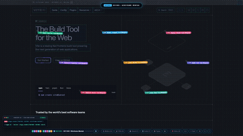
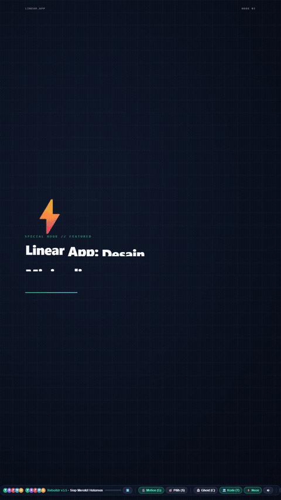

# REBUILDR AI ⚡
### Autonomous Website Motion Engine & 60FPS Video Generator

> **Turn any live website URL into a broadcast-quality 60FPS promotional video, mobile reel, and showcase in seconds.** Powered by 8 synchronized AI cursor agents or autonomous Ghost Self-Building mode.

---

<p align="center">
  
</p>

<p align="center">
  
  
  
  
  
</p>

---

## 🌟 Highlights & Key Features

### 1. 🎬 Dual-View Architecture (Landing Page & Studio Pro)
- **Modern Landing Showcase (`/`)**: Dark-glassmorphic product hero page featuring an interactive device switcher, auto-playing video showcase gallery, feature highlights, and an omnibar input to quickly launch any website URL.
- **Studio Pro Workbench (`/studio`)**: A workstation with a live preview stage, timeline scrubber, standby/resume controls, device mockup switcher, and 4 modular setting tabs (*Preset & Flow*, *Canvas & Frame*, *Visual & AI*, *Audio Studio*).

### 2. 📱 Adaptive Device Mockups (Multi-Platform)
- 💻 **MacBook Pro 16:9 Landscape**: Ideal for YouTube, landing page feature sections, and widescreen desktop presentations.
- 📱 **iPhone 15 Pro Titanium with Dynamic Island (9:16 Vertical)**: Tailored for TikTok, Instagram Reels, and YouTube Shorts with safe-area spacing and automatic mobile viewport injection.
- ⬛ **Square Studio Card (1:1)**: Optimized for Instagram Feed and square portfolio cards.

### 3. 🤖 8-Agent Swarm & Ghost Self-Building Mode
- **8 Synchronized AI Cursors**: Powered by spring-physics animation (`Lead Dev`, `Copywriter`, `Figma Vector`, `WebGL Polygon`, `GSAP Motion`, `Data Analytics`, `Shader FX`, and `Audio/Layout`).
- **Ghost Mode (`C` key)**: Hide all cursors with a single click/keystroke so the website **autonomously builds itself from scratch** (dynamic wireframes draw themselves, polygons triangulate, and typography types automatically).

### 4. ⚡ Direct 60FPS Cloud/Local Headless Video Pipeline
- Captures uncompressed frames via **Chrome DevTools Protocol (CDP)** screencast streaming.
- Real-time encoding into crisp **60FPS MP4** video and high-quality **Lanczos-dithered GIF** using system `ffmpeg`.
- Built-in asynchronous queue to manage concurrent render jobs safely without crashing memory.

### 5. 🛡️ Production-Grade Reverse Proxy & Defused Popups
- **Anti-SSRF Protection**: Restricts target URLs to public hosts and actively blocks access to internal/private IP ranges (`127.0.0.1`, `10.0.0.0/8`, `192.168.0.0/16`, `169.254.0.0/16`).
- **Defused Annoyances**: Locks `window.onbeforeunload` and `document.onbeforeunload` using property descriptors so annoying "Leave site?" confirm dialogs never interrupt recording.

---

## 📸 Device Preview Showcase

| 16:9 Desktop (MacBook Pro) | 9:16 Mobile (iPhone 15 Pro Titanium) |
| :---: | :---: |
|  |  |

---

## 🚀 Quickstart (Running Locally)

### Prerequisites

1. **Node.js** (v18.0.0 or higher recommended)
2. **Google Chrome** installed on your system
3. **FFmpeg** installed and accessible from your system terminal / `PATH`:
   - **Windows** (via winget):
     ```bash
     winget install Gyan.FFmpeg
     ```
   - **macOS** (via Homebrew):
     ```bash
     brew install ffmpeg
     ```
   - **Linux / Ubuntu / Debian**:
     ```bash
     sudo apt update && sudo apt install -y ffmpeg
     ```

---

### Installation & Run

1. **Clone this repository**:
   ```bash
   git clone https://github.com/your-username/rebuildr.git
   cd rebuildr
   ```

2. **Install dependencies**:
   ```bash
   npm install
   ```

3. **Start the local server**:
   ```bash
   npm start
   ```

4. **Open in your browser**:
   ```
   http://localhost:3000
   ```
   - Visit `http://localhost:3000` for the **Landing Showcase**.
   - Visit `http://localhost:3000/studio` to enter the **Studio Pro Workbench**.

---

## ⌨️ Studio Keyboard Shortcuts

| Shortcut | Description |
| :--- | :--- |
| **`Space`** | **Pause / Resume** live studio rebuild animation |
| **`C`** | **Toggle Ghost Mode** (Hide/show cursor swarm) |
| **`B`** | **Cycle Blueprint Themes** (`Figma Grid` → `Architect CAD` → `Cyberpunk Neon`) |
| **`1` / `2` / `3`** | Change animation speed multiplier (`1×`, `2×`, or `3×`) |
| **`R`** | **Replay / Restart** animation from the beginning |
| **`H`** | **Toggle HUD & Header** for borderless clean preview |
| **`Esc`** | **Stop / Restore** original webpage DOM |

---

## 📁 Project Architecture

```
rebuildr/
├── assets/                  # Demo GIF previews & screenshots for documentation
├── public/
│   ├── index.html           # Landing Showcase page
│   ├── landing.css          # Landing page styling & animations
│   ├── landing.js           # Multi-aspect video switcher & omnibar logic
│   ├── studio.html          # Studio Pro Workbench page
│   ├── app.css              # Obsidian glassmorphic workbench styling
│   ├── app.js               # Studio stage controller & render modal logic
│   └── exports/             # Video & GIF showcase assets
├── server.js                # Node.js HTTP server, SSRF proxy & Puppeteer CDP encoder
├── swarm.js                 # 8-Agent DOM deconstruction & kinetic motion engine
├── package.json             # Project metadata and dependencies
├── LICENSE                  # MIT License
└── README.md                # Project documentation
```

---

## 🛠️ Technology Stack

- **Runtime**: Node.js
- **Headless Browser Automation**: Puppeteer-core (Chrome DevTools Protocol)
- **Video & GIF Processing**: FFmpeg
- **Client Engineering**: 100% Vanilla ES6+ JavaScript, CSS3 Variables, Glassmorphism, SVG Triangulation (Zero React/Vue overhead for maximum frame rate)

---

## 📄 License

This project is licensed under the [MIT License](LICENSE) — free to use for personal, open-source, and commercial experiments.
